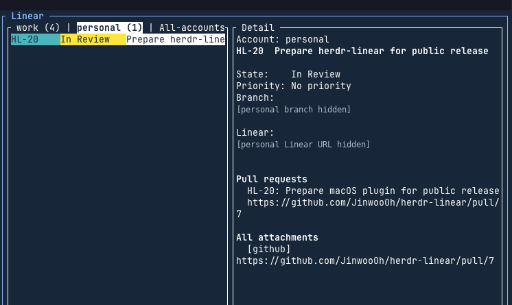
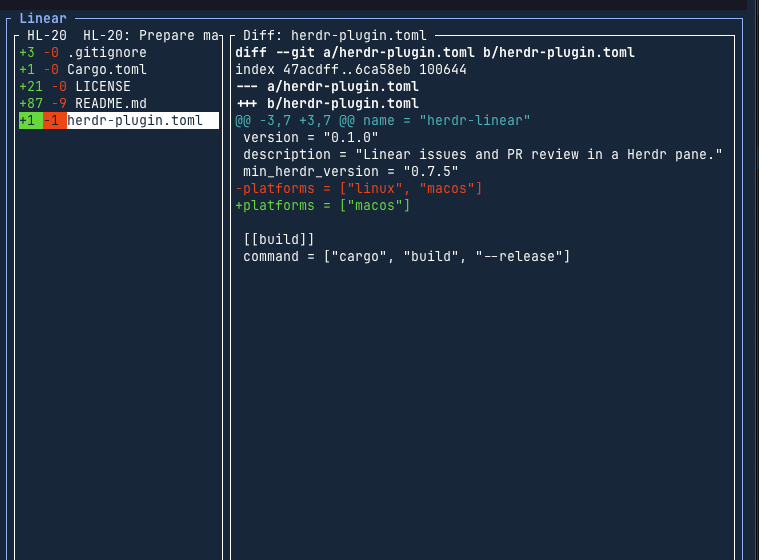

# herdr-linear

Linear issues and GitHub PR review in a [Herdr](https://herdr.dev) pane. Rust + `ratatui`.
See [GLOSSARY.md](GLOSSARY.md) for the domain terms used below.

## Screenshots

### Account tab

Assigned Linear issues and their Linked PRs. Personal branch and Linear URL fields are hidden
in this screenshot.



### PR view

Changed files on the left and the selected file's diff on the right.



## Features

- Assigned open issues per Account; **In Review** first
- Work/personal Account tabs and an **All-accounts queue**, with Account provenance
- Background startup, manual refresh, and 60-second polling; selection preserved by issue ID
- Paginated Linear issue loading (not limited to the first 100)
- PR picker when an issue has several Linked PRs
- Background PR diffs, file navigation, vertical and horizontal scrolling
- Full-file view with syntax highlighting, fetched at the PR's pinned head commit
- Team-specific Linear state picker and background state changes

Polling uses a complete membership snapshot to remove completed, unassigned, or deleted issues;
`updatedAt` identifies unchanged issue objects. One Account failure doesn't disable the others,
and a failed refresh retains the last successful list. The All-accounts queue uses Account + issue ID,
not potentially colliding issue identifiers.

## Requirements

- macOS (Linux and Windows are not validated or advertised)
- Herdr: verified with 0.9.5; the manifest's `min_herdr_version = "0.7.5"` is the original
  build target, not a tested compatibility floor
- Rust 1.100 or newer with Cargo on `PATH` (see `rust-version` in `Cargo.toml`)
- [`gh`](https://cli.github.com) authenticated for the repositories you review (`gh auth status`)
- One Linear personal API key per Account, with write access if you want to change issue states
- A real terminal/Herdr pane for the interactive app (Pi's command runner has no TTY)

## Install as a Herdr plugin

Prerequisites: macOS, Herdr, the Rust toolchain above, authenticated `gh`, and one Linear API key
per Account. Herdr builds this plugin from source; it does not install Rust or `gh` for you.
Ensure `cargo` is on the `PATH` inherited by Herdr (restart Herdr after installing Rust if needed).

**Release preparation:** the repository is currently private. The command below is the intended
public install path after publication; it has not yet passed the fresh-install smoke test.

```sh
herdr plugin install JinwooOh/herdr-linear
```

Herdr checks out the source in a managed directory and runs `cargo build --release` before
registering the plugin. Review the displayed build/runtime commands before confirming.
Do not put keys or configuration in that managed checkout: updates replace it.

Next, follow [Configure](#configure) to create your Account config and key files, then use
[Open the pane](#open-the-pane). For local development, use [Local development](#local-development)
instead of installing over a linked checkout.

## Configure

For standalone use, copy `config.example.toml` to `~/.config/herdr-linear/config.toml`.
For plugin use, put it in the directory printed by:

```sh
herdr plugin config-dir herdr-linear
```

Each Account (one Linear login) can use `key_env` or `key_file`. For example:

```toml
[[accounts]]
name = "work"
key_file = "~/.config/herdr-linear/work.key"

[[accounts]]
name = "personal"
key_file = "~/.config/herdr-linear/personal.key"
```

Save only the corresponding API key in each key file, outside this repository, then:

```sh
chmod 600 ~/.config/herdr-linear/{work,personal}.key
```

Never put credentials in `config.toml`. Without a config file, the app falls back to
`LINEAR_API_KEY` (or the plugin config directory's `api_key` file).

## Build and run

```sh
cargo test --release
cargo clippy --release --all-targets
cargo build --release
./target/release/herdr-linear
```

The interactive app must run in a real terminal, not through Pi's non-TTY command runner.
Restart existing panes after rebuilding; they don't hot-reload the binary.

### Issue list

| Key | Action |
| --- | --- |
| `j` / `k`, arrows | Move |
| `g` / `G` | Top / bottom |
| `Tab`, `Shift+Tab` | Cycle Account tabs and the All-accounts queue |
| `1`–`9` | Select an Account tab |
| `a` | Open the All-accounts queue |
| `Enter` | Open a Linked PR in the PR view; choose one if there are several |
| `s` | Pick a new issue state for its team |
| `r` | Refresh this Account, or all Accounts in the All-accounts queue |
| `q`, `Esc` | Quit (`Esc` first cancels a pending PR load) |
| `Ctrl+C` | Quit from any view |

PR and state pickers: `j/k` or arrows to select, `Enter` to open/apply, `Esc` or `q` to cancel.
States are listed in workflow order (backlog → started → done → canceled), with the current state
preselected and marked. Choosing the current state does nothing. Done, Canceled, and Duplicate
require pressing `y` to confirm; any other key returns to the picker. State changes are submitted
only after that. A submitted mutation cannot be canceled; its
result is routed to the original Account even if you switch Account tabs. Errors leave the original
state intact. If the request times out, the outcome is reported as unknown and the Account is
refreshed to show the real state. Completed/canceled issues disappear from the open list after success.

### PR view

| Key | Action |
| --- | --- |
| `j` / `k`, up/down | Change file |
| `d` / `u`, PageDown/PageUp | Scroll vertically |
| `h` / `l`, left/right | Scroll horizontally |
| `f` | Toggle Full-file view and diff mode (toggling again retries a failed load) |
| `Esc`, `q`, Backspace | Return to issues |

Content and highlighting for Full-file view load off the UI thread and are cached for the current PR view.
Deleted files show their base-commit contents; other files use the head commit, including fork PRs.
Renamed files use their new path. Binary/non-UTF-8, unavailable, submodule, and files over 2 MB
show an explanation instead of crashing. Unknown languages fall back to plain text.
If the PR changes during diff loading, retry to obtain a consistent snapshot. Each `gh` call has a
30-second deadline, and only one full-file load runs at a time. Invisible bidi and zero-width
characters are shown as `<U+XXXX>` (or `�`) rather than rendered silently.

While a PR is loading, a centered box shows the PR, an animated bar, and elapsed time; after a
few seconds it adds a note that large PRs can take a while. The box is modal: `Esc` cancels and
discards the pending result, `q`/`Ctrl+C` quit, and other keys are ignored. Full-file loads and the
state list use the same indicator.
The underlying `gh` process finishes independently; cancellation does not kill it. Issue fetching,
PR fetching, full-file loading, and state changes all happen outside the terminal event loop.

## Open the pane

From a real terminal inside Herdr, invoke the registered action:

```sh
herdr plugin action invoke herdr-linear.open-issues
```

Or open the pane directly:

```sh
herdr plugin pane open --plugin herdr-linear --entrypoint issues --placement split --focus
```

`scripts/open.sh` focuses an existing Linear pane in the current tab instead of opening a duplicate.

Optional launcher binding in `~/.config/herdr/config.toml` (choose an unused key first):

```toml
[[keys.command]]
key = "prefix+shift+l"
type = "plugin_action"
command = "herdr-linear.open-issues"
description = "open Linear pane"
```

Then run `herdr server reload-config`. This is an example, not an automatically installed binding.
With a `ctrl+a` prefix, the example is `Ctrl+A`, then `Shift+L`.

## Local development

`plugin link` registers your checkout but **does not build it**. Build before linking and after changes:

```sh
git clone https://github.com/JinwooOh/herdr-linear.git
cd herdr-linear
cargo build --release
herdr plugin link "$PWD"
```

The repository currently requires GitHub access while private. The same plugin config directory is
used for linked and GitHub-managed installs; keep key files outside the checkout.

## Update and restart

For a GitHub-managed install:

```sh
herdr plugin update herdr-linear
```

For a linked development checkout, pull the desired code and run `cargo build --release` instead.
Close existing Linear panes with `q` and reopen them: updating/rebuilding does not restart them,
and the launcher deliberately focuses an existing pane rather than replacing it.

## Manual smoke test

1. Launch a fresh pane and confirm work and personal Accounts load independently in their Account tabs.
2. Press `a`: the All-accounts queue shows each issue's Account; `r` refreshes all Accounts without freezing.
3. Select an issue with multiple Linked PRs, press `Enter`, choose a Linked PR, and test cancellation/retry.
4. In the PR view, test `f` for Full-file view, `h/l`, `d/u`, and changing files; return with `Esc`.
5. On a disposable test issue, press `s`, cancel once, then select/apply a state. Verify in Linear.
6. Test a missing/invalid key: the other Account must still work.
7. Invoke **Open Linear issues** from the Herdr UI launcher (or its configured keybinding).
   Repeat it and confirm it focuses the existing Linear pane instead of creating a duplicate.

### Fresh GitHub-install smoke test (after publication)

This replaces your plugin registration. Keep a local-checkout path available for recovery, and
confirm your config/key files are outside the plugin root. Uninstalling preserves config/state,
but back up local configuration privately before testing; never copy keys into this repository.

```sh
herdr plugin uninstall herdr-linear
herdr plugin install JinwooOh/herdr-linear
herdr plugin config-dir herdr-linear
```

Confirm the managed checkout's build completes, then invoke **Open Linear issues** from Herdr's
UI launcher and verify both configured Accounts load. Repeat the interactive checks above.
If installation fails, restore local development with `herdr plugin link /path/to/herdr-linear`.
These steps are a pending release gate, not a claim that a fresh install has already been verified.

Read-only GitHub integration test (optional; requires `gh` authentication):

```sh
HERDR_LINEAR_TEST_PR=https://github.com/OWNER/REPO/pull/NUMBER \
  cargo test --release github_live_full_file_snapshot -- --ignored
```

## Tracking

Development is tracked in Linear; PRs reference their HL issue identifiers. The maintainer's
private project URL is intentionally not part of these public-facing instructions.
Automated checks do not substitute for the manual smoke tests above. Webhooks and push
notifications remain out of scope; polling is sufficient.

## License

[MIT](LICENSE).
